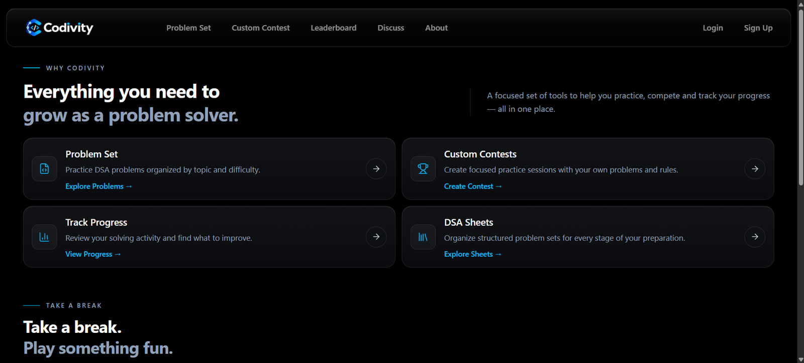
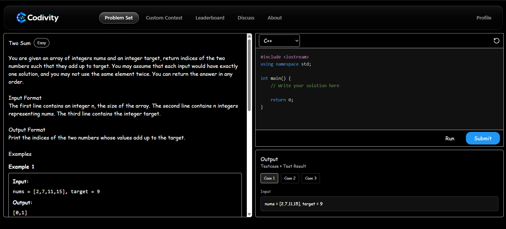
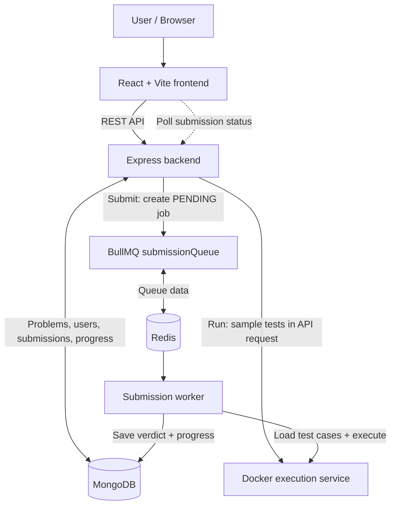

# Codivity

**Practice problems. Run code. Track progress.**

Codivity is a full-stack DSA practice platform built around an online judge. Users can browse programming problems, write solutions in a browser-based editor, execute code against sample tests, submit solutions for evaluation, and review their submission history and progress.

**[Live website](https://codivity.app)** · **[Source code](https://github.com/Prash072004/codivity-phase1)** · **[GitHub profile](https://github.com/Prash072004)**

> **About this repository:** This is the **Phase 1 snapshot** of Codivity, not necessarily the code currently deployed at codivity.app. The live site and later development commits may contain additional features or a different execution pipeline. This README describes the code in this repository.

## Overview

Codivity combines a React frontend with an Express API, MongoDB persistence, and Docker-based code execution. Full submissions are processed asynchronously through **BullMQ + Redis** and a separate submission worker, keeping long-running judging work out of the request handler. Users can check a pending submission until the final verdict is available.

The platform is designed as a practical full-stack engineering project, with particular focus on **code execution, background job processing, user progress, and clear feedback for coding problems**.

## Features

### Implemented in this snapshot

- **Problem catalog:** Browse programming problems grouped by topic, with difficulty and solved-status indicators.
- **Problem workspace:** Read statements, constraints, input/output formats, and examples beside the code editor.
- **Language-aware editor:** Source editing with syntax highlighting and language selection. The execution configuration defines C++17, Python 3.12, and JavaScript (Node.js 22); available choices also depend on active language records in the database.
- **Run Code:** Execute against **sample test cases** and inspect per-case status, input, expected output, actual output, stderr, and runtime.
- **Submit Solution:** Create a persistent `PENDING` submission, queue it with BullMQ, and poll for the final verdict.
- **Judge feedback:** Return verdicts such as Accepted, Wrong Answer, Compilation Error, Runtime Error, or Time Limit Exceeded, as applicable.
- **Progress tracking:** Track attempted/solved problems, preserving a solved state after subsequent unsuccessful submissions.
- **User accounts:** Sign up, sign in, and sign out using password hashing and JWT-based authentication with HTTP-only cookies.
- **Profile and history:** View profile activity and paginated submission history.

### Routes present but not yet developed

The `Custom Contest`, `Leaderboard`, `Discuss`, and `Create DSA Sheet` pages are **placeholder screens** in Phase 1. They should not be interpreted as completed product features.

## Screenshots

The following are **development screenshots provided by the project author**. They illustrate Codivity's design direction; they may not be pixel-identical to the archived Phase 1 source.

**Homepage**



**Problem workspace**



> When updating this README for a specific release, replace these images with screenshots taken from that exact revision. Screenshot assets are stored under `docs/screenshots/`.

## Tech stack

| Layer | Technology |
| --- | --- |
| Frontend | React, JavaScript, Vite, Tailwind CSS, React Router, Axios |
| Backend | Node.js, Express |
| Data storage | MongoDB, Mongoose |
| Authentication | JWT, bcrypt, HTTP-only cookies |
| Background jobs | BullMQ, Redis |
| Code execution | Docker, configured language runtime/compiler images |
| Interface | Lucide icons, custom browser-based code editor |

## Architecture



### Two distinct evaluation paths in Phase 1

**Run Code:** The Express run controller executes sample tests directly using the execution service and returns their results in the HTTP response. It does **not** create a persisted submission.

**Submit Solution:** Express creates a `PENDING` submission in MongoDB and adds a job to the Redis-backed BullMQ queue. The worker retrieves the problem and its test cases, executes the code, determines the verdict, and updates the submission and user progress. Judging stops at the first failing test. The frontend polls for the result.

> **Version note:** A later Codivity implementation routes both Run and Submit through a worker and compiles once for multiple cases. Those improvements are **not present in this Phase 1 repository**, so they are intentionally not represented as implemented here.

## Repository structure

```text
codivity-phase1/
├── backend/
│   ├── config/                # Execution-language configuration
│   ├── controllers/           # API request handlers
│   ├── middleware/            # Authentication middleware
│   ├── models/                # MongoDB/Mongoose models
│   ├── routes/                # Express endpoints
│   ├── services/              # Execution and judging logic
│   ├── worker/                # BullMQ submission worker
│   ├── server.js              # Express API entry point
│   ├── submissionQueue.js     # Queue definition
│   ├── redis.js               # Redis connection
│   └── package.json
├── frontend/
│   ├── src/
│   │   ├── components/        # Navbar, editor, problem details, etc.
│   │   ├── pages/             # Routes and feature pages
│   │   └── services/api.js    # Axios API client
│   └── package.json
├── docs/
│   └── screenshots/           # README screenshots (add with this README)
└── docker-compose.yml        # Redis service for local development
```

## Getting started locally

### Prerequisites

- Node.js and npm (use a modern version compatible with the repository's Vite, React, and Express dependencies).
- Docker Desktop / Docker Engine with the daemon running.
- A MongoDB instance (local or MongoDB Atlas) and its connection URI.
- Git.
- A Docker image suitable for the selected execution language; see **Execution images** below.

### 1. Clone and install dependencies

```bash
git clone https://github.com/Prash072004/codivity-phase1.git
cd codivity-phase1

cd backend
npm install

cd ../frontend
npm install

cd ..
```

### 2. Start Redis

From the repository root:

```bash
docker compose up -d redis
```

The included Compose file starts **Redis only** on port `6379`; it does not start the API, worker, frontend, or MongoDB.

### 3. Configure environment variables

Create `backend/.env` (do not commit it):

```dotenv
PORT=5000
NODE_ENV=development
MONGODB_URI=mongodb://127.0.0.1:27017/codivity
REDIS_URL=redis://localhost:6379
JWT_SECRET=replace_with_a_long_random_secret
CORS_ORIGIN=http://localhost:5173
```

If you use MongoDB Atlas, replace `MONGODB_URI` with your own connection string. Never commit credentials or production secrets.

Create `frontend/.env`:

```dotenv
VITE_API_URL=http://localhost:5000/api/v1
```

**Important:** The frontend's code defaults to `http://localhost:3000/api/v1`, whereas the backend defaults to port `5000`. Set `VITE_API_URL` as above for a consistent local setup.

### 4. Prepare execution images

The language configuration refers to:

| Language | Expected Docker image |
| --- | --- |
| C++17 | `codivity-cpp-execution:dev` |
| Python | `python:3.12-slim` |
| JavaScript | `node:22-alpine` |

For a **local development-only** C++ image, one quick option is to tag an image with GCC installed:

```bash
docker pull gcc:13
docker tag gcc:13 codivity-cpp-execution:dev
```

The Docker daemon must remain accessible to the API and submission worker. The C++ configuration uses `g++ -std=c++17 -O2`. Language records must also exist and be marked active in MongoDB for the frontend to offer them. This project snapshot does not document a one-command database seeding workflow.

> **Security:** The quick GCC image is a development convenience, **not** a hardened production sandbox. Do not expose arbitrary-code execution publicly without reviewing container privileges, host isolation, resource controls, filesystem access, and deployment security.

### 5. Start the API, worker, and frontend

Open three terminals from the repository root.

**Terminal 1 — Express API**

```bash
cd backend
node server.js
```

**Terminal 2 — BullMQ worker**

```bash
cd backend
npm run worker
```

**Terminal 3 — React frontend**

```bash
cd frontend
npm run dev
```

Then open **http://localhost:5173**. The API is configured at **http://localhost:5000**.

> For judging to work, MongoDB must contain appropriate problems, test cases, and active language records. An empty database can run the application but will not offer meaningful sample problems or submissions.

## Execution and submission lifecycle

1. A user selects a problem and programming language, then writes a solution.
2. **Run Code** executes the sample cases and returns individual results without creating a submission.
3. **Submit Solution** stores a `PENDING` submission and queues a BullMQ job.
4. The submission worker loads the code, problem, language, and test cases from MongoDB.
5. Docker-based execution applies resource restrictions and reports the available execution outcome.
6. The judge compares output against expected output and stops at the first failing test.
7. MongoDB stores the verdict and pass count; the user's solved/attempted state is updated.
8. The frontend requests the submission status until the final result is available.

## Development checks

Frontend scripts:

```bash
cd frontend
npm run lint
npm run build
```

The `backend/package.json` in this snapshot has a placeholder `npm test` script rather than a configured automated test suite. Do not treat `npm test` as a passing backend test command for Phase 1.

## Known limitations

- **Archived implementation:** The live Codivity application or current main repository may differ from this Phase 1 snapshot.
- **Run is synchronous:** Sample runs are handled in the API request in this version; only full submissions use the BullMQ worker.
- **Per-case execution overhead:** The execution service starts a container and compiles C++ code for each test case instead of compiling once and reusing the artifact.
- **Not a full Docker Compose stack:** The checked-in Compose file provisions Redis only. MongoDB, API, worker, frontend, and execution images require separate setup.
- **Database content required:** Problem data, test cases, and active languages must be configured before the judge is useful.
- **Placeholder pages:** Custom Contest, Leaderboard, Discuss, and Create DSA Sheet are not functional features in this snapshot.
- **Measurements:** Runtime is elapsed execution time including overhead; memory usage may be unavailable. Do not treat these as exact CPU and memory profiling metrics.
- **Security and scaling:** Container-level restrictions do not by themselves establish production-grade sandboxing. Public, multi-tenant judging requires additional hardening, monitoring, and operational controls.
- **Testing:** A complete automated backend/integration test suite is not provided in this snapshot.

## Roadmap (not included in Phase 1)

Later development may include a worker-based sample Run flow, compile-once execution, refined result panels, expanded contest and learning tools, production worker hosting, and richer operational checks. These are **future or separate-version capabilities**, not claims about this archive.

## Maintainer

**[Prash072004](https://github.com/Prash072004)** — Codivity project.

For questions, suggestions, or bug reports, please use the repository's [GitHub Issues](https://github.com/Prash072004/codivity-phase1/issues).
